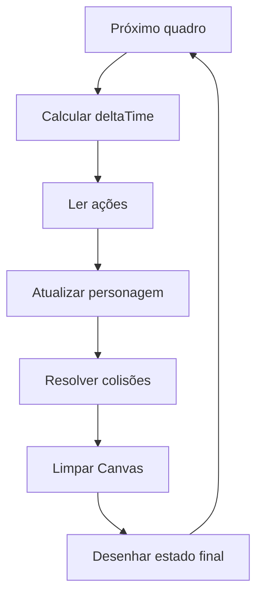

# Base do jogo — primeira sprint

Projeto de jogo de plataforma educativo, feito com HTML, CSS e JavaScript. A primeira sprint prepara uma fase de teste antes da integração dos desafios de programação.

Este repositório contém a **base de estrutura e integração do Marlon**: página responsiva, Canvas, inicialização, ciclo central, retângulo de teste e pontos de conexão para os demais módulos.

## 1. Como executar

Você precisa de um navegador com suporte a módulos JavaScript e de Python 3 para o servidor de desenvolvimento. O jogo não utiliza bibliotecas externas e não exige instalação de pacotes.

Se você ainda não possui o projeto:

```bash
git clone https://github.com/Marllonlp/ccxp.git
cd ccxp
```

O repositório é privado: o proprietário precisa conceder acesso aos integrantes. Se o projeto já está no seu computador, abra o terminal na pasta `ccxp`.

Inicie o servidor:

```bash
python3 -m http.server 8000 --bind 127.0.0.1
```

No Windows, caso o comando `python3` não exista, utilize:

```bash
py -m http.server 8000 --bind 127.0.0.1
```

Abra **http://localhost:8000** no navegador. Mantenha o terminal aberto e use `Ctrl+C` para encerrar o servidor.

### Por que um servidor local?

O HTML carrega `main.js` como um módulo. Ele utiliza `import` para buscar `game.js`. Por isso, execute a página por HTTP: abrir o arquivo diretamente com `file://` pode bloquear o carregamento dos módulos.

### Resultado esperado

- A mensagem “Base carregada. Retângulo de teste em exibição.” aparece.
- Um retângulo vermelho é desenhado sobre o Canvas azul.
- A área dos controles aparece fora do Canvas.
- Os botões estão desativados: eles reservam espaço para a entrega de teclado e toque do Pedro.
- O retângulo permanece parado; o ciclo o redesenha a cada quadro.

Captura da base no computador:


### Abrir no celular pela rede local

Coloque computador e celular na mesma rede Wi-Fi. No computador, encerre o servidor anterior e execute:

```bash
python3 -m http.server 8000 --bind 0.0.0.0
```

Descubra o IP local do computador. No Linux, você pode consultar `hostname -I`; no Windows, `ipconfig`. No celular, abra `http://IP_DO_COMPUTADOR:8000`, substituindo `IP_DO_COMPUTADOR` pelo endereço encontrado, por exemplo `192.168.1.20`.

`localhost` no celular aponta para o próprio celular; use o IP do computador que executa o servidor.

## 2. Estrutura e responsabilidades

```text
ccxp/
├── index.html                 Página, Canvas e espaço dos controles — Marlon
├── styles/
│   └── main.css               Apresentação responsiva — Marlon; controles com Pedro
├── src/
│   ├── main.js                Inicialização e ligação dos módulos — Marlon
│   ├── game.js                Ciclo, tempo e ordem das chamadas — Marlon
│   ├── input.js               Teclado e toque — Pedro
│   ├── player.js              Estado e movimentação — Pedro
│   ├── level.js               Dados do cenário — Dudu
│   └── collisions.js          Detecção e resolução dos contatos — Dudu
├── assets/
│   ├── characters/            Imagens do personagem — Kelvis
│   ├── tiles/                 Chão, plataformas e paredes — Kelvis
│   └── ui/                    Imagens dos controles — Kelvis
├── docs/
│   └── guia-marlon.md          Explicação detalhada da base
└── README.md                  Execução e acordos de integração — Marlon
```

Os arquivos dos demais integrantes possuem somente comentários de orientação. As pastas de imagens contêm `.gitkeep` porque o Git não registra pastas vazias. Esses arquivos podem ser removidos quando as imagens forem adicionadas.

## 3. Resolução e coordenadas

O Canvas tem resolução interna fixa de **960 × 540**. Essa é a superfície usada pelos cálculos e desenhos.

- `(0, 0)` é o canto superior esquerdo.
- `x` aumenta para a direita.
- `y` aumenta para baixo.
- Posições, velocidades e dimensões devem usar o espaço interno do jogo.
- O CSS ajusta a exibição à tela mantendo a proporção 16:9.
- Não altere `canvas.width` e `canvas.height` ao redimensionar a janela: isso mudaria as coordenadas e apagaria o desenho.

Em telas baixas na horizontal, o painel de controles fica ao lado. Nas demais, fica abaixo. A composição atual é uma referência de integração para receber o design do Kelvis.

## 4. Como o ciclo funciona



`requestAnimationFrame` chama o ciclo quando o navegador prepara o próximo quadro. A cada chamada, `game.js` calcula:

```js
deltaTime = (tempoAtual - tempoAnterior) / 1000;
```

Dividimos por 1000 porque o navegador informa milissegundos e a movimentação deve trabalhar em segundos. Exemplo: uma velocidade de 100 pixels por segundo, durante `0.016` segundo, corresponde a `1.6` pixel de deslocamento.

O primeiro quadro usa `deltaTime = 0`. O intervalo é limitado a `0.05` segundo para impedir que uma interrupção produza um deslocamento muito grande. Após uma mudança de visibilidade da página, o relógio é reiniciado.

O ciclo expõe `start()`, `stop()` e `destroy()` para controlar sua execução técnica. `start()` evita iniciar duas repetições simultâneas; `stop()` cancela o próximo quadro; `destroy()` também remove o observador de visibilidade. As regras e a interface de pausa da fase serão desenvolvidas na etapa de RF07.

## 5. Pontos de integração da equipe

`startGame` recebe o Canvas, o contexto e, opcionalmente, um objeto com quatro funções:

| Função | Argumentos recebidos | Função na integração |
| --- | --- | --- |
| `readActions` | Nenhum | Lê as ações fornecidas por `input.js`. |
| `updatePlayer` | `actions`, `deltaTime` | Chama a movimentação de `player.js`. |
| `resolveCollisions` | `deltaTime` | Ajusta o personagem com os obstáculos de Dudu. |
| `drawScene` | `context`, `canvas` | Desenha o estado resultante, usando as imagens quando disponíveis. |

Essa ordem já está implementada. Enquanto as funções não forem fornecidas, as ações ficam desligadas, as atualizações não alteram o estado e o desenho usa o retângulo de teste.

### Ações combinadas

```js
{
  esquerda: false,
  direita: false,
  pulo: false,
  agachamento: false
}
```

Os botões reservados no HTML possuem `data-action` com esses mesmos nomes. O módulo de Pedro deve habilitar os botões quando estiver integrado. Teclado e toque precisam alimentar as mesmas ações. Pedro define com a equipe como sinalizar um novo acionamento de pulo, evitando repetir o salto enquanto o botão estiver segurado.

### Dados compartilhados

Personagem e obstáculos precisam compartilhar pelo menos `x`, `y`, `width` e `height`, em pixels internos. Velocidades, contato com o chão, posição anterior e estado de agachamento são acordados por Pedro e Dudu conforme a resolução das colisões.

Marlon conecta as funções em `main.js`. O estado do personagem e do cenário pode ser compartilhado pelas funções de integração, como no exemplo abaixo.

### Exemplo para quando os módulos estiverem prontos

Os nomes `createInput`, `createPlayer`, `updatePlayer`, `createLevel` e `resolveCollisions` abaixo são uma **proposta de acordo**, não funções já implementadas. Confirme as assinaturas com os responsáveis antes de aplicar este exemplo.

```js
import { startGame } from './game.js';
import { createInput } from './input.js';
import { createPlayer, updatePlayer } from './player.js';
import { createLevel } from './level.js';
import { resolveCollisions } from './collisions.js';

const canvas = document.getElementById('game-canvas');
const context = canvas.getContext('2d');
const input = createInput(document.querySelector('.mobile-controls'));
const player = createPlayer();
const level = createLevel();

startGame(canvas, context, {
  readActions: () => input.getActions(),
  updatePlayer: (actions, deltaTime) => updatePlayer(player, actions, deltaTime),
  resolveCollisions: (deltaTime) => resolveCollisions(player, level.obstacles, deltaTime),
  drawScene: (context) => {
    context.fillStyle = '#475569';
    for (const obstacle of level.obstacles) {
      context.fillRect(obstacle.x, obstacle.y, obstacle.width, obstacle.height);
    }
    context.fillStyle = '#e63946';
    context.fillRect(player.x, player.y, player.width, player.height);
  },
});
```

O exemplo mostra a ligação dos módulos. O agachamento e a verificação de espaço para levantar também precisam ser conectados entre Pedro e Dudu. A ordem e os dados necessários para resolver cada eixo da colisão devem ser combinados antes da integração.

## 6. Colaboração no repositório

O remoto configurado é `git@github.com:Marllonlp/ccxp.git`. O repositório é privado. Pedro, Dudu e Kelvis precisam receber acesso pelos seus nomes de usuário do GitHub e aceitar eventuais convites.

Cada integrante deve criar uma branch para sua tarefa. Exemplo para uma tarefa do personagem:

```bash
git switch main
git pull --ff-only
git switch -c feat/personagem-controles
```

Depois da implementação, registre somente os arquivos da tarefa, faça o commit e publique a branch:

```bash
git add src/player.js src/input.js
git commit -m "feat: implementar personagem e controles"
git push -u origin feat/personagem-controles
```

Abra um pull request e peça revisão de outro integrante. Marlon integra pequenas entregas, mantendo uma versão executável.

## 7. Condição de conclusão da parte do Marlon

| Entrega | Situação técnica |
| --- | --- |
| Estrutura de arquivos e pastas | Preparada, com espaços reservados para os módulos e imagens. |
| Canvas e área dos controles | Implementados e adaptáveis à tela. |
| Inicialização do contexto 2D | Implementada, com mensagem em caso de falha. |
| Ciclo e tempo entre quadros | Implementados. |
| Retângulo de teste | Implementado. |
| Ordem e pontos de integração | Implementados e documentados. |
| Instruções de execução | Documentadas para computador e celular. |
| Acesso dos integrantes | Depende da identificação e confirmação dos usuários do GitHub. |
| Execução pelos quatro integrantes | Precisa ser confirmada por cada pessoa no próprio dispositivo. |
| Integração da fase jogável | Depende das entregas de personagem, controles, cenário, colisões e imagens. |

### Conferência de execução da equipe

Cada integrante deve confirmar que consegue obter o projeto, iniciar o servidor e visualizar a base. Atualize esta tabela somente após a confirmação real:

| Integrante | Obteve o projeto | Executou no dispositivo |
| --- | --- | --- |
| Marlon | A confirmar pelo integrante | A confirmar pelo integrante |
| Pedro | Pendente | Pendente |
| Dudu | Pendente | Pendente |
| Kelvis | Pendente | Pendente |

### Conferência da base

- Abra a página pelo servidor e confira o retângulo e a mensagem de inicialização.
- Reduza a largura e confirme que o Canvas mantém a proporção.
- Confira a área reservada em celular na vertical e na horizontal.
- Mude de aba e retorne; a base deve continuar desenhando.
- Confira o console do navegador para erros de inicialização ou importação.

Para a fase jogável, aplique os testes do plano da sprint após a integração dos módulos: movimentação, parada, salto, pouso, paredes, teto, agachamento e toque simultâneo.

## 8. Explicação detalhada

Leia [o guia da parte do Marlon](docs/guia-marlon.md) para entender cada arquivo, o ciclo, a matemática do tempo e os pontos de integração.

Consulte também [o registro das verificações realizadas](docs/verificacoes.md), com os tamanhos de tela conferidos e as limitações da validação.

## 9. Etapas posteriores

O plano deixa pausa/reinício e checkpoints para depois da validação da base. PWA, armazenamento de progresso e desafios de programação fazem parte do projeto completo e terão implementação e divisão de responsáveis próprias. A execução local desta base não implementa instalação PWA nem funcionamento offline após fechar o servidor.
