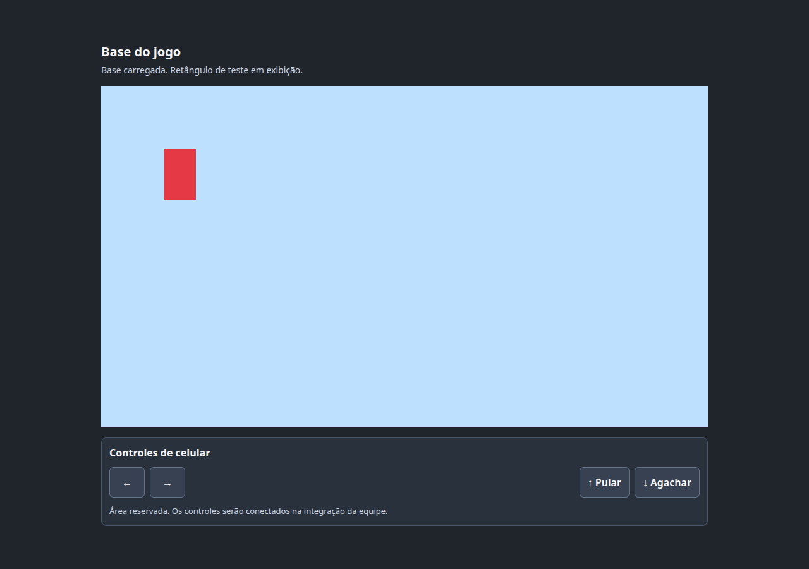
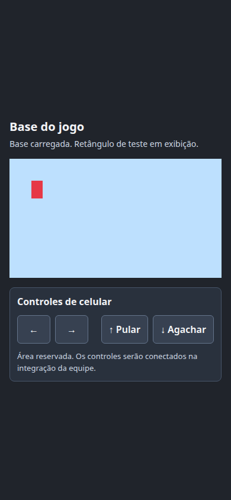

# Verificações da base

Data: **3 de outubro de 2026**. Foram verificados os arquivos da base do Marlon. A validação da fase jogável será realizada após a integração das entregas da equipe.

## Código JavaScript

A verificação de sintaxe passou para todos os arquivos de `src` usando `node --check`, no Node.js 22.22.1.

O ciclo foi executado com horários de quadros controlados. Essa verificação confirmou:

- Leitura de ações antes da movimentação.
- Movimentação antes das colisões.
- Colisões antes da limpeza e do desenho.
- Recebimento dos mesmos objetos de ações e desenho pelos pontos de integração.
- Intervalo zero no primeiro quadro.
- Conversão de 16 milissegundos para `0.016` segundo.
- Limite de `0.05` segundo após um intervalo longo.
- Reinício do relógio ao mudar a visibilidade e ao reiniciar o ciclo.
- Uma única sequência de quadros ao chamar `start` repetidamente.
- Cancelamento do quadro pendente com `stop`.
- Encerramento definitivo da instância com `destroy`.

## Navegador

A página foi carregada pelo servidor HTTP no Google Chrome em modo headless, utilizando emulação de tamanhos de janela e de tela móvel.

| Tela | Resolução interna | Tamanho apresentado do Canvas | Resultado |
| --- | --- | --- | --- |
| Computador: 1280 × 900 | 960 × 540 | 960 × 540 | Aprovado |
| Celular: 390 × 844 | 960 × 540 | 358 × 201,375 | Aprovado |
| Celular estreito: 320 × 568 | 960 × 540 | 288 × 162 | Aprovado |
| Celular horizontal: 844 × 390 | 960 × 540 | Aproximadamente 497,77 × 279,98 | Aprovado |

Em todos esses tamanhos foram confirmados:

- Inicialização concluída e mensagem de estado atualizada.
- Proporção 16:9 na exibição.
- Ausência de rolagem horizontal.
- Painel de controles separado do Canvas, sem sobreposição.
- Quatro botões reservados com as ações combinadas e desativados nesta base.
- Desenho do retângulo vermelho confirmado pela leitura de um pixel interno.
- Nenhuma exceção JavaScript registrada durante a execução.

Os arquivos HTML e JavaScript foram servidos com sucesso pelo servidor local; os módulos foram entregues como `text/javascript`.

## Capturas

Computador:

Celular:

## O que depende da equipe

A emulação de tela não substitui a confirmação nos aparelhos dos quatro integrantes. As colunas de execução do README permanecem pendentes até cada integrante confirmar o resultado.

Movimentação, teclado, toque, cenário, colisões e imagens ainda precisam ser fornecidos pelos responsáveis e conectados aos pontos de integração. Os testes da fase de plataforma serão aplicados nesse momento.

Instalação PWA, execução offline, progresso local e desafios de programação não fazem parte da implementação desta base da primeira sprint.
